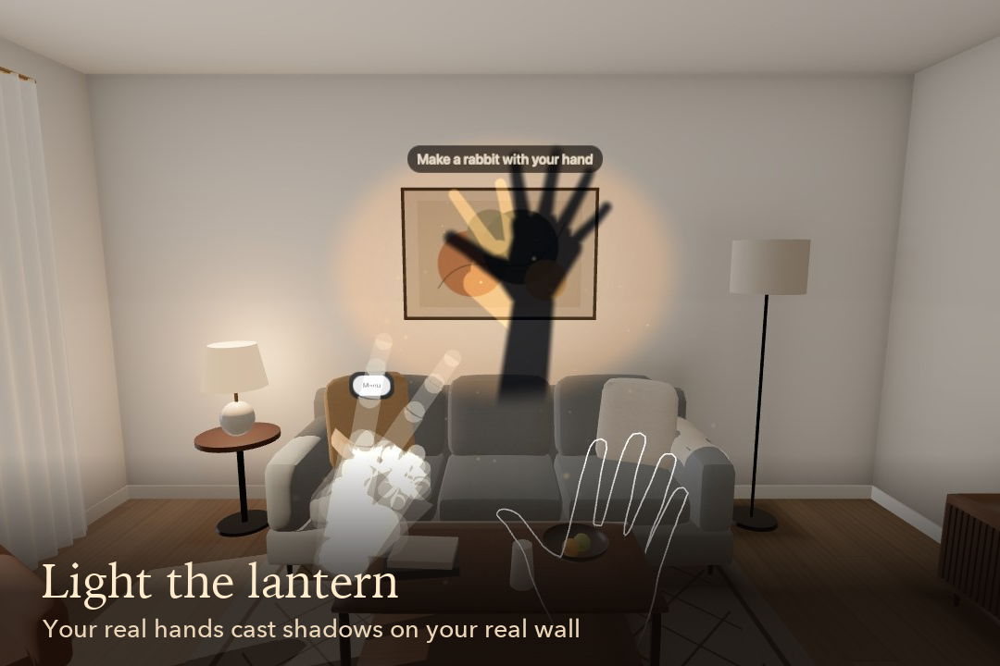
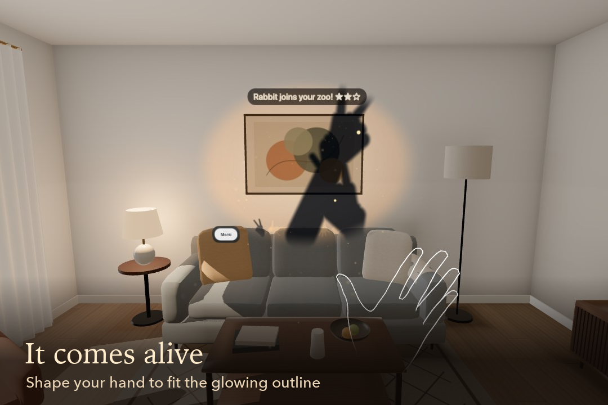
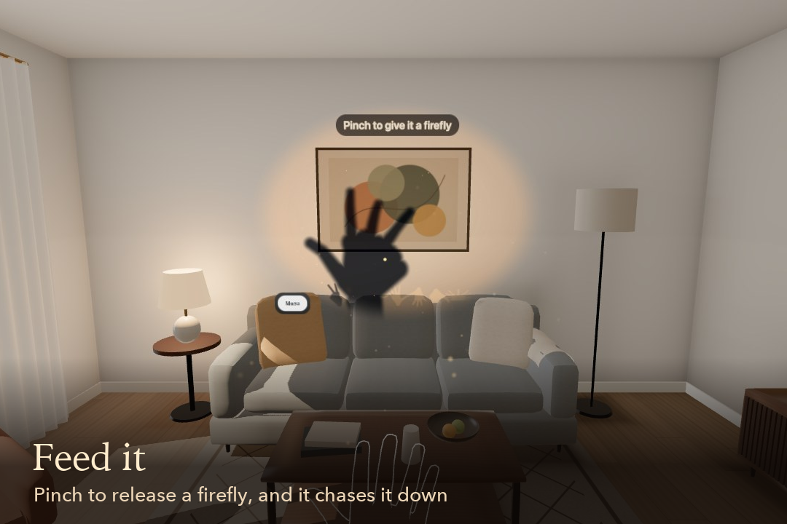
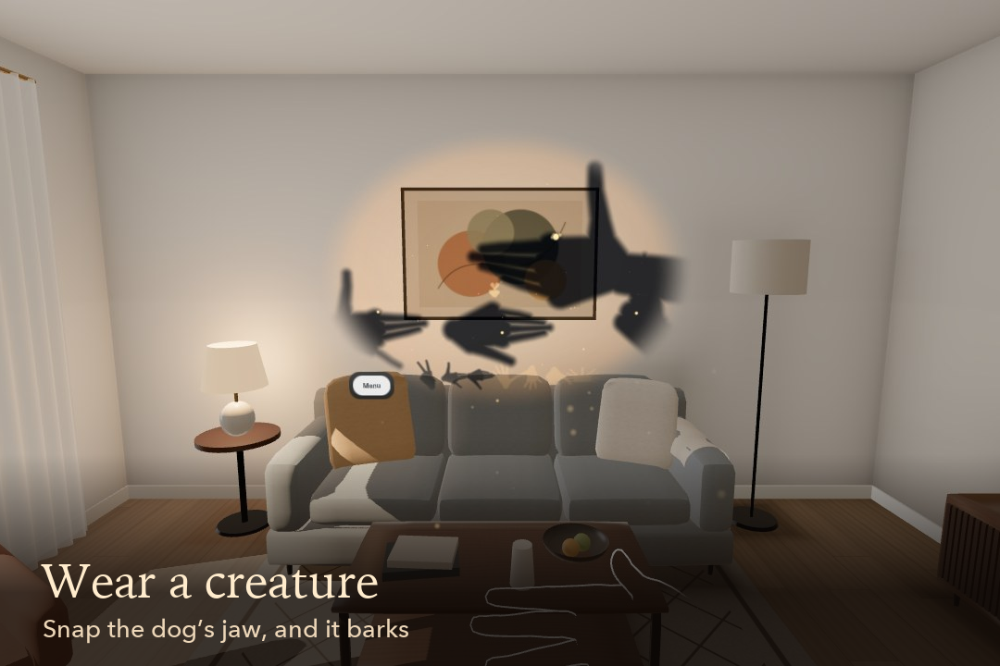
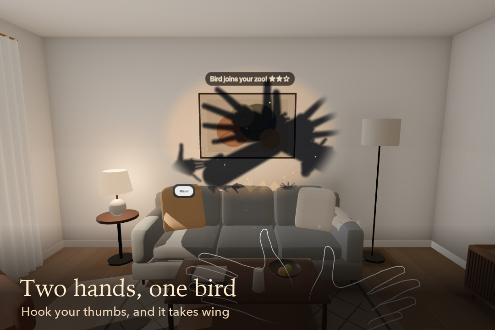
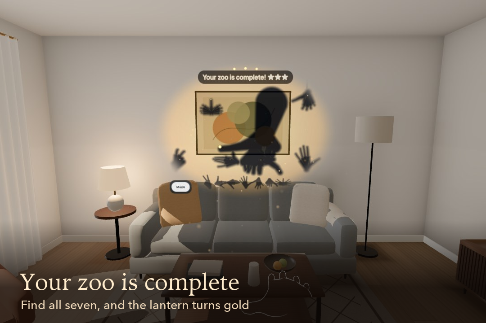
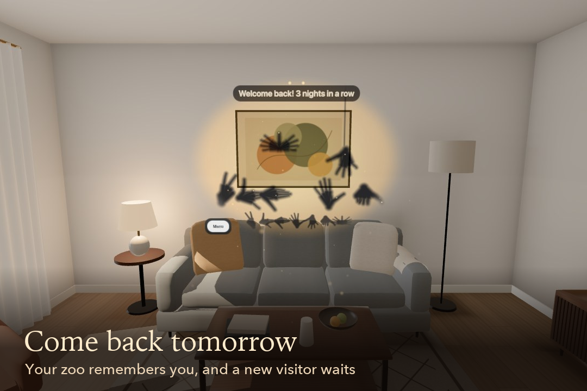
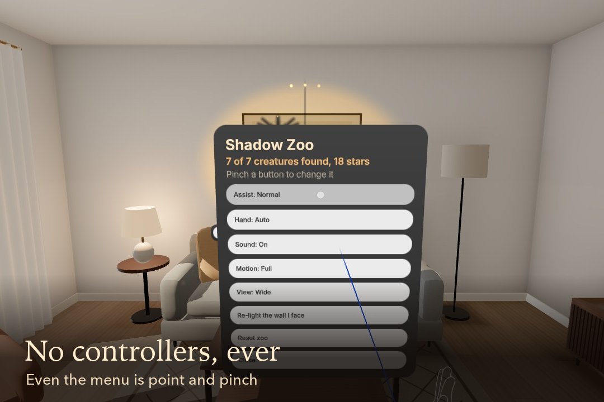

# Shadow Zoo

Make shadow animals with your bare hands on your real wall, and watch them come alive.

> Every kid has made a rabbit on the wall with a flashlight. Shadow Zoo is what happens when the rabbit hops off your hand, and stays.

Entry for the Meta VR Start Developer Competition 2026: Gaming track, New Experience division.

| | |
|---|---|
| Play it | https://ankitlade12.github.io/shadow-zoo/ (Meta Quest Browser on Quest 3 or 3S) |
| Demo video | https://youtu.be/UDuvUWqNC5c (2:08, narrated and captioned) |
| Devpost | https://devpost.com/software/shadow-zoo |
| No headset? | The same link opens a desktop preview: your real hands through a webcam, or the mouse |
| Built with | Meta's Immersive Web SDK (WebXR), three.js, TypeScript, Web Audio |

## The idea

Shadow puppets are the oldest mixed reality there is: a light, a wall and your hands. Shadow Zoo puts a warm virtual lantern behind you, lights the wall you are facing, and lets the shadows your real hands cast come alive. It only works with your real room and your real hands. Switch passthrough off and there is no game.

## Who it's for

**Players.** Anyone who has ever made a rabbit on the wall, from a five-year-old to a grandparent. It's seated, hands-only and playable within two feet, with a complete moment in under ten minutes. No reading is required: a glowing ghost hand demonstrates every shape.

**Judges.** It's one link with nothing to install. On a Quest it plays in Meta Quest Browser. Without a headset, the same link runs a desktop preview in Meta's WebXR emulator.

## Screenshots

| | |
|---|---|
|  |  |
| Light the lantern: your real hands cast shadows on your real wall. | Shape your hand to fit the glowing outline, and the creature comes alive. |
|  |  |
| Pinch to release a firefly, and your creatures chase it down. | Make a creature you've found and wear it: snap the dog's jaw and it barks. |
|  |  |
| The classic: hook your thumbs, spread your fingers, and the bird takes wing. | Find all seven creatures and the lantern turns gold. |
|  |  |
| Your zoo remembers you, and a daily visitor brings a twist. | Even the menu is point and pinch. |

All screenshots are taken from the demo video: IWSDK WebXR emulator footage with emulated hand tracking.

## How it plays

1. **Light the lantern.** The game finds the wall you face and lights a warm pool on it.
2. **Make the shape.** A glowing outline appears. Shape your hand until its shadow fits, and the creature wriggles free. There are seven to discover: rabbit, dog, crocodile, peacock, spider, turtle, and the bird, which takes both hands.
3. **Play with them.**
   - **Feed:** pinch to release a firefly.
   - **Pet:** rest your shadow on a creature to earn hearts. At three hearts it learns a trick.
   - **Wear:** make the shape of a creature you've found and become it. Snap its jaw and it speaks; the dog's bark scatters the rabbits.
4. **Grow your zoo.** Every match earns up to three stars, and a row of silhouettes on the wall shows who is still missing. Finding the last one sets off a finale and turns the lantern gold.
5. **Come back tomorrow.** Your zoo is saved on your device, your streak warms the lantern, and a daily visitor brings a twist: a shy one you must hold perfectly still, or a big one that needs your hand closer to the light.

## How it works

| Piece | What it does | Where |
|---|---|---|
| Wall | Plane detection finds the wall you face (labeled walls first, then large planes, so a picture frame never wins) and builds the stage, the light pool and the lantern on it. If no wall is found, the game falls back to a paper screen in front of you. | [stage.ts](src/core/stage.ts), [StageSystem.ts](src/systems/StageSystem.ts) |
| Hands to shadows | All 25 joints of each tracked hand are projected from the lantern onto the wall as tapered capsules. They're drawn into a small 2D mask in one instanced pass, then composited over passthrough with a single quad. | [HandSystem.ts](src/systems/HandSystem.ts), [projector.ts](src/core/projector.ts), [ShadowCanvas.ts](src/render/ShadowCanvas.ts) |
| Candlelight | Shadow edges soften with distance from the wall, the way a small flame's do. The flame flickers and sways, and dust drifts in the beam. | [lantern.ts](src/core/lantern.ts), [Dust.ts](src/render/Dust.ts) |
| Matching | Shadows are normalized for position and size, then scored by overlap plus a 64-direction radial signature that finds the rotation and checks the ears, jaws and legs. A short hold and a gently relaxing threshold keep it fair. Two-handed creatures score both hands together. | [silhouette.ts](src/core/silhouette.ts), [matcher.ts](src/core/matcher.ts), [Visitors.ts](src/game/Visitors.ts) |
| Creatures | Each creature is itself a hand shadow that blends between a base pose and an action pose, with its own gait: hop, trot, slither, strut, dangle, creep or fly. As the zoo fills, everyone eases to a shared size and spreads out along the ground. | [library.ts](src/core/library.ts), [creature.ts](src/core/creature.ts), [Zoo.ts](src/game/Zoo.ts), [crowd.ts](src/core/crowd.ts) |
| Wearing | When your shadow matches a creature you've found, you wear it; closing its jaw (or ears, legs or head) gives it a voice. | [Puppeteer.ts](src/game/Puppeteer.ts), [puppet.ts](src/core/puppet.ts) |
| Progress | Guided first visitors, stars, the zoo row, the finale, the streak and daily twists, saved to the device. | [Progression.ts](src/game/Progression.ts), [rewards.ts](src/game/rewards.ts), [daily.ts](src/core/daily.ts), [save.ts](src/core/save.ts), [Session.ts](src/game/Session.ts) |
| Teaching | Short captions and a glowing ghost hand that demonstrates each shape, including both hands for the bird. | [Onboarding.ts](src/game/Onboarding.ts), [GhostHand.ts](src/render/GhostHand.ts) |
| Menu | A chip on the wall opens a panel near you: assist level, hand, sound, reduced motion, a narrow view for Meta VR Glasses, Re-light and Reset. It's operated by pointing and pinching. | [MenuSystem.ts](src/systems/MenuSystem.ts), [menu.uikitml](public/ui/menu.uikitml), [Settings.ts](src/game/Settings.ts) |
| Sound | Every sound is synthesized with the Web Audio API and placed on the wall in 3D, so there are no audio files. | [AudioEngine.ts](src/audio/AudioEngine.ts), [recipes.ts](src/audio/recipes.ts) |
| Desktop preview | Browsers that can't start mixed reality load Meta's WebXR emulator with a virtual living room, then play with real hands through the webcam (MediaPipe, on the device) or with the mouse. Quest Browser never downloads any of it. | [detect.ts](src/preview/detect.ts), [emulator.ts](src/preview/emulator.ts), [tracker.ts](src/preview/camera/tracker.ts), [PreviewSystem.ts](src/systems/PreviewSystem.ts) |

## Try it (for judges)

**On Meta Quest 3 or 3S**

1. Open https://ankitlade12.github.io/shadow-zoo/ in Meta Quest Browser.
2. Sit facing a wall in a lit room and put your controllers down.
3. Press **Light the lantern**, and allow hand tracking and spatial data when asked.
4. A rabbit outline appears within a few seconds. Make the rabbit (index and middle fingers up, the others folded) and it comes alive. The captions take it from there.

**On a computer**

Open the same link in Chrome, Edge, Safari or Firefox.

- **Real hands:** press **Light the lantern, with my real hands** and hold a hand up to your camera. Make a V for the rabbit. The camera picture stays on your device.
- **Mouse:** press **or play with the mouse**. Move the mouse to move your shadow and press **1** to **7** to make the shapes: 1 is the rabbit, and 7 is the two-handed bird. Click to pinch, hold Space to snap a worn creature's jaw, and scroll for a bigger shadow. **Esc** leaves.

## How Shadow Zoo meets the judging criteria

### Innovation and creativity

- The input is the shape of your hand, not a gesture or a button. Each creature is a real shadow puppet you can make in any room, and two hands make the bird.
- Passthrough and scene understanding are the game: the lantern lights the wall you face, and moving your hand toward it grows and softens its shadow, as with real light.
- The game is built to bring you back: a zoo that remembers you, a streak that warms the lantern, and daily visitors with twists.

### Experience design

| The competition's test | Shadow Zoo |
|---|---|
| Hands-first: never pair a controller | Every interaction is a hand shape, a pinch, a resting shadow or point-and-pinch on the menu. |
| Airplane seat: everything within two feet | It's played seated. The comfortable hand point is 40 cm in front of you and 30 cm below your eyes. |
| One bus stop: a complete moment in under ten minutes | The first creature comes alive within the first minute; a session is a few minutes. |
| Take it away: original, not a wrapper | It has no third-party service. The shadow engine, matching, creatures and sound are all built for this game. |
| FoV-aware | The light pool stays within about 40 by 30 degrees, and a narrow view for Meta VR Glasses is in the menu. |

### Technical implementation

- WebXR hand tracking (all 25 joints, with radii) and plane detection through the Immersive Web SDK, with semantic wall labels when available.
- It's built to hold up in rooms we never tested: it prefers real walls by size and label, ignores pictures and windows, and falls back to a paper screen.
- It's light enough for standalone hardware: one instanced mask pass of at most 1,024 capsules, one composite quad, one 64-point dust draw, and no image or audio files to load.
- There are 188 automated tests (Vitest) covering the projection, matching, every creature's robustness to hand size, rotation and noise, progression, saving, the session flow, the desktop preview and camera mapping. An emulator drill brings all seven creatures to life with the emulator's built-in hand poses.

### Polish and presentation

- One art direction throughout: warm candlelight, soft shadows, cream type, and the same lantern glow from the landing page to the finale.
- Sound is synthesized and placed in space: crickets from the wall, a voice for each creature, chirps for fireflies.
- The demo video is real gameplay with a narrated walkthrough, captions and an original score.

## What's real and what's emulated

- **Real:** the game, the hosted build, and everything in the video and screenshots is real gameplay of this code.
- **Emulated:** it was built and tested in Meta's IWSDK WebXR emulator (IWER), with emulated hand tracking in a virtual living room. The video says so on screen. Its voiceover is [Kokoro](https://huggingface.co/hexgrad/Kokoro-82M), an open text-to-speech model under the Apache 2.0 license, in an Indian English voice. Its music is an original score synthesized by [scripts/score.py](scripts/score.py). Its game sound is rebuilt offline from the game's own sound engine at the moments the game played it.
- **Not yet verified:** a physical Quest. Real hand-tracking noise, passthrough contrast in real rooms and on-device frame rate still need a headset test.

## Limitations

- It hasn't been tested on a physical headset yet (see above).
- The zoo is saved only in this browser on this device. There are no accounts and no sync between devices.
- The desktop preview is a convenience for people without a headset. The game is designed for tracked hands on Quest.

## Privacy

- Progress and settings are saved only in this browser's `localStorage`. There are no accounts, analytics or AI services.
- Hand joints are used in memory to draw shadows and are never stored or sent.
- In the desktop preview, camera hands are optional. The picture is analyzed in the page and is never stored or sent, and the camera turns off when you leave.

## Run locally

Requires Node 20.19+, 22.12+ or 24+.

```bash
npm install
npm run dev          # IWSDK dev server with the WebXR emulator (Meta Quest 3 in a synthetic living room)
npm test             # 188 tests (Vitest)
npm run typecheck
npm run build        # static site in dist/; GitHub Actions deploys main to GitHub Pages
```

`bash scripts/drill.sh` plays a fresh game in the emulator with built-in hand poses and times every creature's match. It needs a headless dev server: `./node_modules/.bin/iwsdk dev up --ai-mode agent --headless`.

**Rebuilding the demo video and screenshots** (ffmpeg, Pillow and numpy required):

```bash
./node_modules/.bin/iwsdk dev up --ai-mode agent --headless --allow-browser-automation --screenshot-width 1280 --screenshot-height 720
bash scripts/demo.sh                                                  # plays and records the scripted demo
./node_modules/.bin/iwsdk browser run scripts/render-audio.mjs --timeout 110000
~/.venvs/shadow-zoo-tts/bin/python scripts/synth_voice.py            # the voiceover in Kokoro (setup in the script)
python3 scripts/record_voice.py                                      # or record it yourself, line by line
python3 scripts/narrate.py                                           # the voiceover track from those takes
python3 scripts/score.py                                             # the original music, timed to the beats
python3 scripts/encode.py                                            # the captioned video, in docs/video/
python3 scripts/gallery.py                                           # docs/gallery/, plus thumbnails in docs/
```

## Project structure

```
src/
  core/        game math and rules, no WebXR (unit-tested): stage, projection, silhouettes,
               matching, creatures, crowding, lantern, saves, daily visitors
  game/        the game: hand shadows, visitors, wearing, the zoo, progression, rewards,
               onboarding, the session
  render/      the shadow canvas, captions, ghost hand, dust
  audio/       the Web Audio engine and synthesized sound recipes
  systems/     IWSDK ECS systems: hands, stage, menu, game, render, sound, desktop preview
  preview/     desktop preview: browser check, emulator, mouse controls, camera hands
  ui/          the landing page
public/ui/     the menu (UIKitML)
tests/         Vitest suite
scripts/       emulator drill and the demo video pipeline
docs/gallery/  screenshots from the demo video
```

## License

[MIT](LICENSE). Bundled third-party components are listed in [THIRD_PARTY_NOTICES.md](THIRD_PARTY_NOTICES.md).
